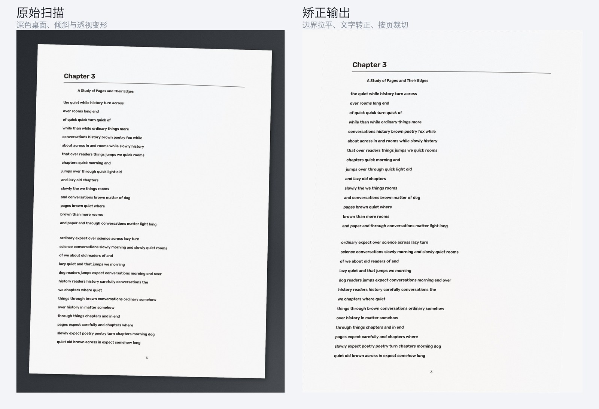
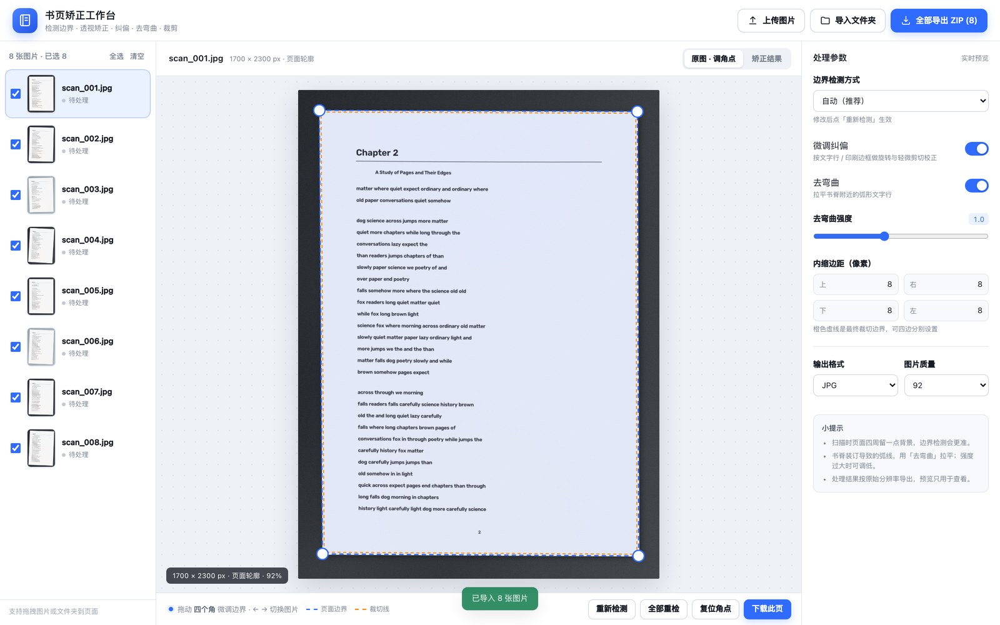
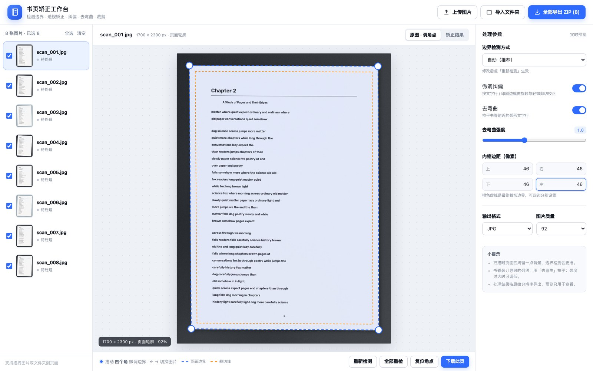
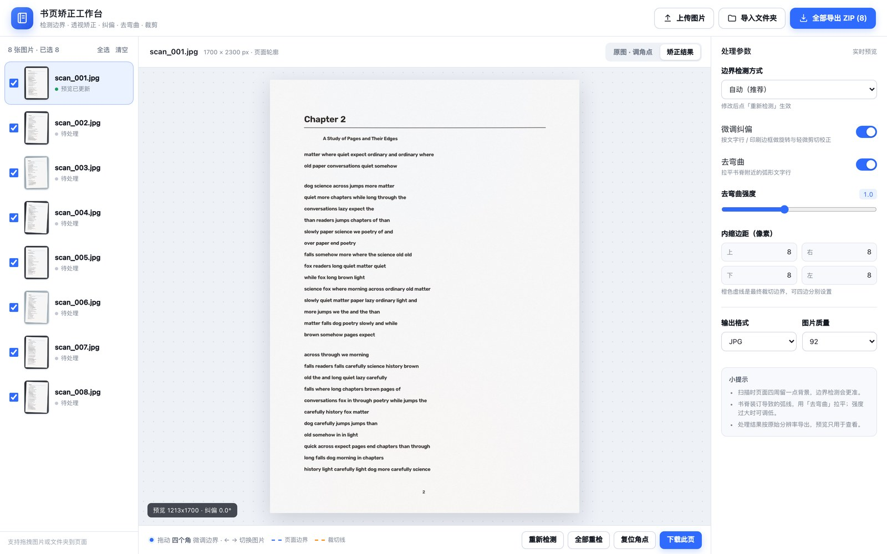

扫描一本书，麻烦的往往不是 OCR，而是页面本身没有摆正：书没有完全压平，手机或扫描仪带一点角度，书脊附近的文字弯成弧线，四周还留着桌面、底衬和投影。

`cut-fit-page` 是我为此写的一个本地小工具。它不做识别，只解决页面几何：找出一页纸的四个角，把透视拉平，纠正残余倾斜，尽量展平文字行的弯曲，最后按原始分辨率裁切导出。网页端可以逐页拖动角点、实时看结果；命令行也能直接处理整个文件夹。



*左侧是带桌面背景、倾斜和透视变形的合成扫描图；右侧是同一页经过边界检测、透视矫正、纠偏和裁切后的输出。*

## 一条图像处理链路

整个处理过程是顺序的，每一步都为下一步准备更“正”的输入：

```text
读图
 ├─ 边界检测（亮度轮廓 / 纸张颜色两路候选）
 ├─ 边线精修（沿法线向外寻找真实纸张边缘）
 ├─ 四点透视变换（把四边形拉成矩形）
 ├─ 微调纠偏（长直线估计横纵轴，旋转 + 轻微剪切）
 ├─ 去弯曲（按文字行估计逐列纵向位移场）
 └─ 内缩边距 → 按原始分辨率导出
```

核心算法都在 `app/pipeline.py` 里，只依赖 OpenCV 和 NumPy。网页服务、命令行、测试共用同一套函数，避免出现“网页里调好了，批处理结果却不一样”的情况。

## 边界检测：不押注单一阈值

书页检测最容易犯的错，是假设“纸张一定比背景亮”。深色桌面上这成立，浅色底衬上却未必；泛黄旧书页与白色扫描背景的亮度也可能非常接近。

因此 `detect_page()` 会同时准备两路候选：

**亮度轮廓**：灰度图做高斯模糊和 Otsu 二值化，正反两种极性都尝试；用形态学闭运算把纸张区域连起来，再找面积足够大、接近矩形的外轮廓。候选会按面积占比、矩形填充率打分，并对“贴着图像四边”的轮廓降权，避免把整张画布当成页面。

**纸张颜色**：转到 Lab 空间，比较纸张与图像边缘背景的 `b` 通道（黄—蓝）。旧书页通常比中性底衬更黄，而投影的色度更接近背景，因此颜色通道能把“纸张”和“纸张的阴影”分开。这一路只在背景足够亮、色度接近中性时启用，再用边缘两侧的色差确认四边形确实包住了纸面。

两路结果不会简单相加，而是比较面积比例后选更可信的一路；如果亮度轮廓没有找到可靠页面，而颜色区域足够大，就优先采用颜色结果。

得到轮廓后，代码不会直接把 `approxPolyDP` 的四个点当作最终角点。每条边会先用 `fitLine` 做两轮稳健拟合，剔除离群点，再求四条直线的交点。这样角点可以落在亚像素位置，也不会因为轮廓上某个锯齿而整体偏移。拟合后还会检查面积变化，超出合理范围就退回原始四边形。

### 边线停在印刷框上怎么办

旧书页常见一种情况：外侧页边褪色、卷曲，颜色掩膜停在内部的黑色印刷框，而不是真正的纸张边缘。

针对这个问题，检测后会再做一次“向外精修”：对每条边，检查外侧一小段区域是否仍然是纸张颜色；如果是，就沿边法线向外搜索亮度与色度的强梯度长线，取最外侧的峰值重新拟合该边，再与相邻边求交。只有移动距离和面积增长都在合理范围内才会接受，避免把桌面纹理误当成纸边。

## 拉成矩形之后，还有两件事

四点透视变换按对边长度取输出尺寸，尽量保留原始分辨率。但“把四边形拉成矩形”只解决了大形状，页面内部仍可能残留两类问题。

### 残余倾斜：优先相信长直线

纠偏先从图像中找长直线，分别估计横向和纵向轴的角度。文字行、印刷边框、表格线都会提供方向；只保留长度足够的线，并按长度加权取中位数，避免零散笔画干扰。

如果横纵两个方向都有可靠估计且夹角足够明显，就做一次小角度仿射，让文字的行与列重新正交；如果仿射会让画布移动太多，就放弃这次校正。如果只有一路方向可靠，或角度太小，则退回投影法：在 ±10° 内逐角度旋转二值图，统计水平投影方差，取峰值，再做 0.05° 的细化。

### 去弯曲：按文字行建立位移场

书脊装订会让文字行呈弧形，靠旋转无法修正。去弯曲的做法是：

1. 自适应二值化得到墨迹，横向闭运算把同一行的字连成条带；
2. 过滤掉太短、太高、贴边的连通域；
3. 对每条文字行，按列取中位 `y`，用二次多项式拟合弯曲基线；
4. 把各行的局部纵向偏移汇总成逐列位移场，做中值/MAD 离群裁剪和高斯平滑；
5. 边缘逐渐收敛到零，避免把页面边框一起拖动；
6. 用 `cv2.remap` 反向映射，按 1024 行分块处理，控制大图的内存峰值。

它假设页面主要是横向排版的文字。漫画、整页图片、复杂表格没有稳定的文字行，效果会明显下降；强度调得过大也可能让笔画变形，所以网页里保留了 0–2.5 的强度滑杆。

## 工作台：让参数有可见的反馈

算法参数如果只能靠改代码，很难判断一次调整是否有效。网页端用 FastAPI 提供接口，前端是原生 HTML/CSS/JS，没有构建步骤，启动后直接打开就能用。

[](pics/editor-source.jpg)

*上传后自动检测四角，左侧是页面列表，右侧是检测方式、纠偏、去弯曲与输出参数。*

几个交互细节是围绕“看得见”来做的：

- 上传后自动检测并生成缩略图，点任意一页进入编辑；
- 四个白色角点可以拖动，修改会保存到服务端，刷新页面不丢；
- 修改检测方式、去弯曲强度、内缩边距后，右侧会重新渲染结果预览；
- 内缩边距按上、右、下、左分别设置，原图上用橙色虚线实时标出最终裁切位置；
- 预览图有尺寸上限，导出始终按原图分辨率处理。

[](pics/editor-margins.jpg)

*把四边内缩调到 46 px 后，橙色裁切线会和蓝色页面边界分开显示，便于确认是否会切到页边内容。*

[](pics/editor-result.jpg)

*切到「矫正结果」后，页面被拉成矩形，背景和桌面被裁掉；底部显示输出尺寸与纠偏角度。*

服务端把上传原图、预览图和元数据写入 `data/`，页面角点也保存在 JSON 元数据里。默认只监听本机，也可以设置 `CUTFIT_DATA` 换存储位置。对一批书页来说，这个“上传—检查—微调—导出”的循环比反复运行脚本更直接。

## 批处理与导出

同样的流程可以用命令行跑：

```bash
# 处理整个目录，输出到 ./rectified
uv run cutfit ./scans

# 指定输出目录、四边边距、格式与质量
uv run cutfit ./scans -o ./out \
  --margin-top 10 --margin-right 12 \
  --margin-bottom 10 --margin-left 12 \
  --format png --quality 95

# 关闭去弯曲，递归子目录，8 线程
uv run cutfit ./scans --recursive --workers 8 --no-dewarp

# 保存检测到的角点，便于复查或复用
uv run cutfit ./scans --save-quads quads.json
```

网页端的批量导出会把勾选页面打进一个 ZIP，文件名沿用原文件名，重名自动加后缀；单页导出保留原始分辨率。批处理与网页导出共用 `rectify()`，参数含义一致。

## 验证与已知边界

仓库里的测试用合成扫描图验证了几件事：

- 检测角点与真实角点的平均误差小于 8 px；
- 矫正后页面长宽比接近原始纸张，内容非空；
- 对弯曲页面，去弯曲后的文字行斜率显著下降；
- 上传、预览、渲染、单页导出、批量 ZIP、删除与批量重检接口可用。

这些测试能防止算法在重构时明显退化，但不能代替真实扫描件的验收。当前的已知边界包括：

| 场景 | 当前行为 |
| --- | --- |
| 一张图里左右两页摊开 | 默认按“一张图 = 一页”处理，需要手动把角点收在其中一页，或先拆图 |
| 页面与背景同色、没有可见边界 | 自动退化为整张图片，需要手动调角点 |
| 深色桌面、木纹背景 | 纸张颜色检测通常不启用，走亮度轮廓 |
| 漫画、整页图片、复杂表格 | 去弯曲依赖文字行，效果有限 |
| 手机照片的 EXIF 方向 | 未特殊处理，方向不对需要先转正 |

## 跑起来

需要 Python 3.10+ 和 [uv](https://docs.astral.sh/uv/)：

```bash
cd cut-fit-page
uv sync
uv run uvicorn app.main:app --port 8765
```

浏览器打开 <http://127.0.0.1:8765>。如果想先看效果，可以生成一组合成扫描图：

```bash
uv run python scripts/make_samples.py -o samples -n 8
```

然后在网页里点「导入文件夹」选择 `samples/`。测试用 `uv run pytest -q`。

这个工具目前只处理页面几何：它不会替你识别文字，也不会修复纸张本身的破损。但把边界、透视、倾斜和弯曲这几步稳定下来之后，后续无论是阅读、打印还是送进 OCR，输入都会干净很多。
